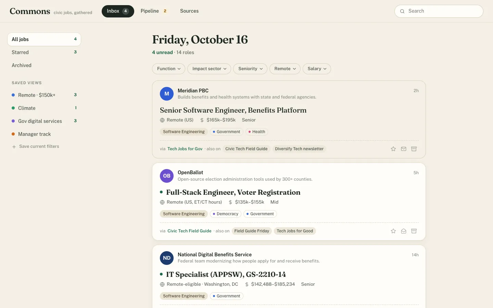
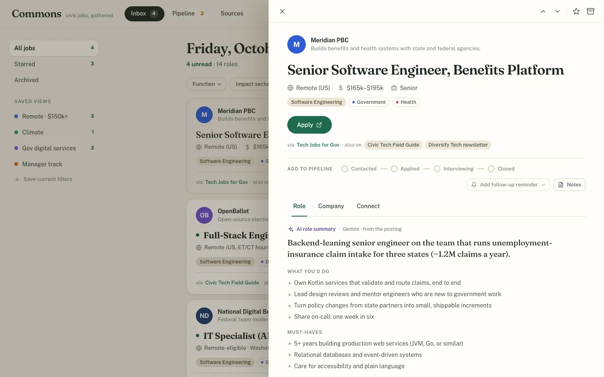
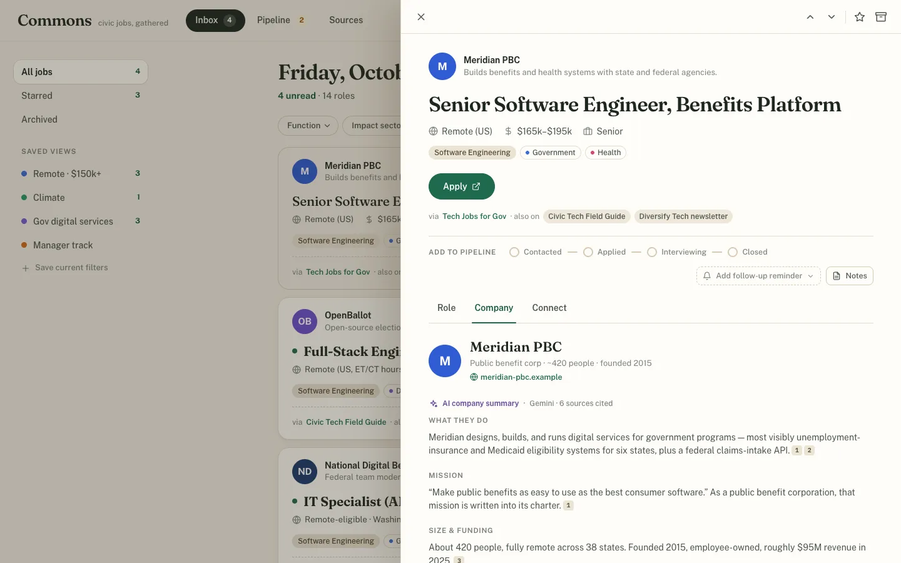
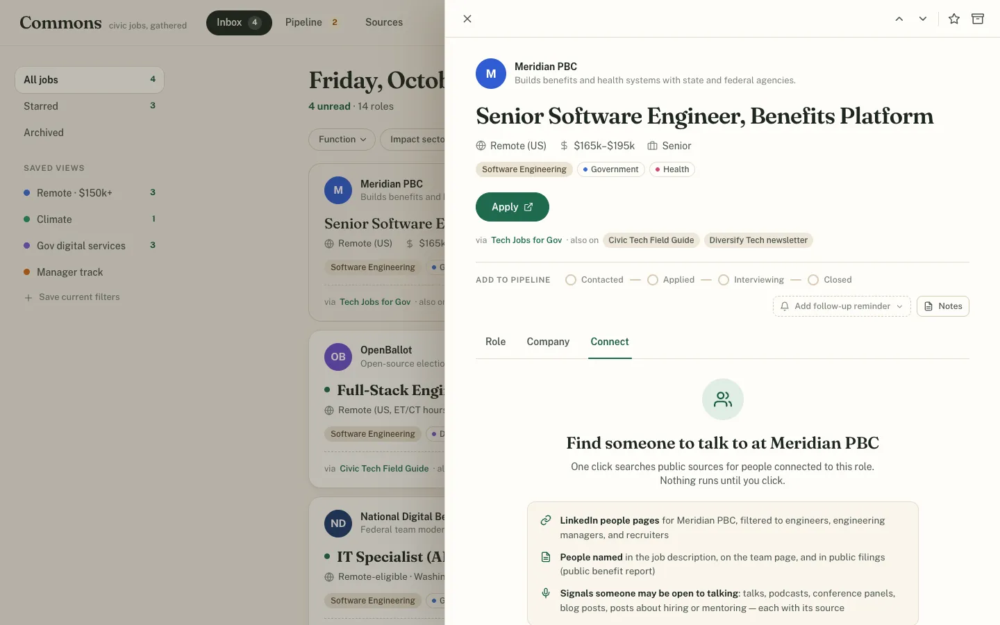
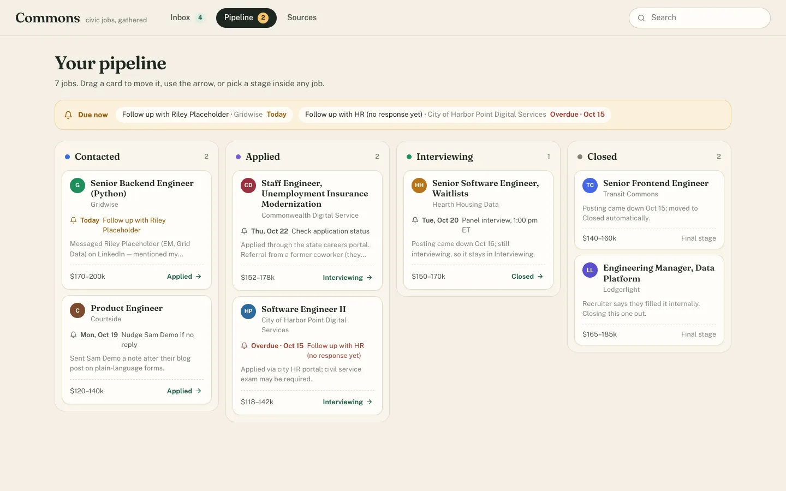

# Design: Commons

Direction B, "Commons", from the clickable prototype is the chosen design for
the app. The screenshots below show it with fictional sample data.

## Decisions the build follows

- **Commons tokens:** background `#f4efe5`, surface `#fffdf8`, ink `#1d2721`,
  accent `#1f6a4e`; Fraunces headings, Public Sans body; pill buttons and
  chips, round logos.
- **Pipeline stages:** contacted → applied → interviewing → closed, any stage
  selectable at any time. Starring is separate and replaces a "saved" stage.
- **Postings that come down:** hidden unless in the pipeline; a tracked job
  moves to closed with a note, except one at interviewing, which stays.
- **Read state:** unseen jobs are bold with an unread dot; "mark seen" and
  "archive" are separate actions. No application deadlines.
- **No keyboard shortcuts** in v1.
- **Intro drafts are generic** in v1. A LinkedIn "alumni of your school" link
  and its "your school" setting come later.
- **Phone and tablet layouts** are a separate design pass; these screens are
  desktop only.

## Screens

### Inbox

### Job detail: Role tab

### Job detail: Company tab

### Job detail: Connect tab

### Pipeline

